# 白日梦工厂 · Daydream Factory

一个可自行部署的短剧创作平台：导入剧本后，整理角色、地点和道具，编写资产视觉提示词，拆分集、分镜与视频提示词；同时自带团队协作、积分计费、在线充值和完整的运营后台，开箱即可作为一个多人使用的短剧创作服务运行。

- **从剧本到分镜**：剧本解析、资产提取、分集分镜、分集视频生产，每一步都能回到剧本原文核对。
- **个人与团队空间**：邀请成员、分配角色与积分，项目共享与编辑占用，团队资源可交接。
- **积分与支付**：按模型定价、生成前预估、团队折扣、在线充值与退款扣回。
- **运营后台**：账号、团队合同、模型与价格、积分策略、支付订单、用量、邮件、通知与品牌设置。
- **一键部署**：一条命令启动整套服务，前端（nginx）与后端分别打包为镜像，无需手工建库或准备运行环境。

## 一键部署

安装并启动 Docker（Compose v2.20+），下载源码 ZIP 并解压，在源码根目录执行：

```sh
sh deploy.sh
```

脚本会自动构建前端与后端两个应用镜像、生成私有基础设施凭据、初始化空库并启动整套系统，无需手工建库、执行 SQL、安装 Go/Node.js 或准备字体。首次构建需要联网，资源要求见[部署指南](guide/deployment.md#部署前准备)。

- 工作台：<http://127.0.0.1:8787/demo/app/>
- 运营后台：<http://127.0.0.1:8787/demo/app/#/operations-login>

### 体验账号

全新部署自带以下公开账号，密码都是 `Daydream123456`，开箱即可体验运营、团队协作与积分分配：

| 身份 | 登录账号 | 可以体验 |
| --- | --- | --- |
| 运营（初始账号） | `Daydream` | 运营后台、个人创作空间；工作台与运营后台通用 |
| 团队所有者 | `owner@daydream.local` | 「演示团队」的成员管理、积分分配、充值 |
| 团队管理员 | `admin@daydream.local` | 管理成员，花本人名下分配的积分 |
| 团队成员 | `member@daydream.local` | 使用名下积分创作、申请积分 |

演示团队开通时带 5,000 积分，并已给管理员、成员各分配一部分。**演示收银台默认开启**：在运营后台「充值档位与限额」上架档位后，工作台即可完整走一遍下单、模拟支付和积分到账，不会真实扣款。

启动后，在运营后台配置自己的分析模型 API Key、启用模型并设置积分价格，再到工作台选择模型、导入剧本并开始；完整顺序见[第一次使用](guide/deployment.md#第一次使用)。默认仅供本机访问，单人体验无需先配置邮件。

### 上线前

体验配置只适合本机试用。对外提供服务前：

1. 修改 `Daydream` 的密码，并在运营后台「用户管理」停用三个演示账号。
2. 关闭演示收银台、切换到正式环境，需要收款时按[支付与商户部署](guide/payments.md)接入微信或支付宝。修改方法见[部署指南](guide/deployment.md#上线前关闭演示配置)。

## 功能一览

以下截图均来自真实界面，使用本地演示与测试数据；新部署不附带这些数据。

### 剧本到分镜

- **剧本导入与解析**：支持 TXT、Markdown、DOCX（最大 20 MB）或直接粘贴文本；创建时选择画面风格、画幅比例和分析模型。
- **角色、地点、道具资产**：从剧本中提取资产，编辑视觉描述与提示词；每条结论都带剧本原文出处，可随时回到原文核对。
- **分集与分镜**：按集整理场景与镜头，生成引用资产的视频提示词。
- **分集视频生产**：按镜头组织图片与视频任务，查看排队、进度、结果与失败原因。
- **创作资产库**：上传素材与生成结果集中管理，在项目之间筛选、复用。
- **生成前预估积分**：发起生成前显示预计消耗，价格变化时要求重新确认；生成未完成会自动返还积分。

| 项目工作台 | 角色资产 |
| --- | --- |
| 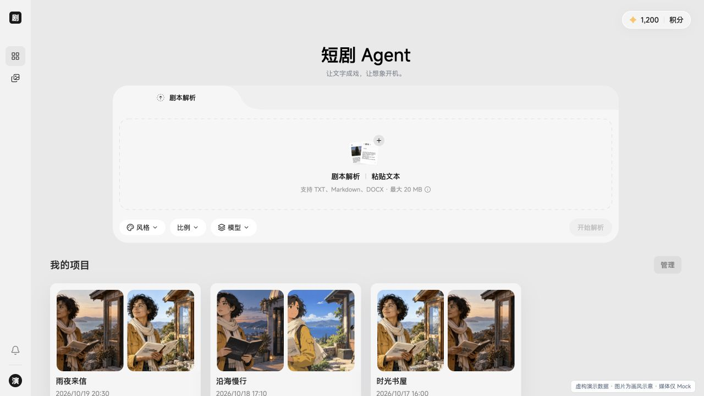 | 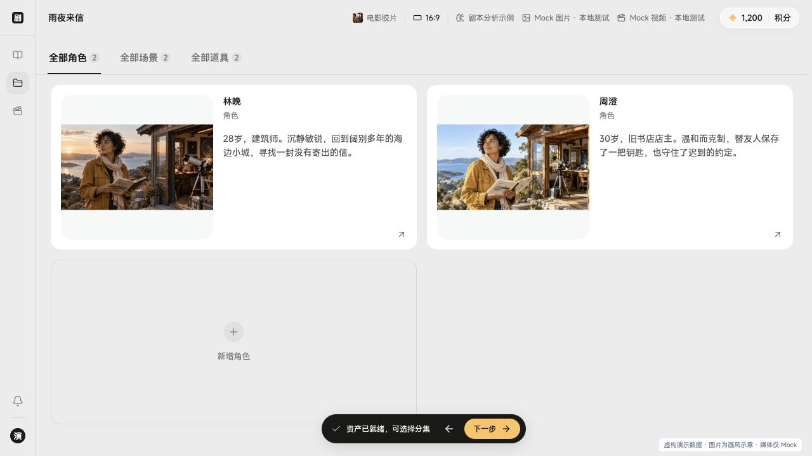 |
| **分镜创作** | **运营后台** |
| 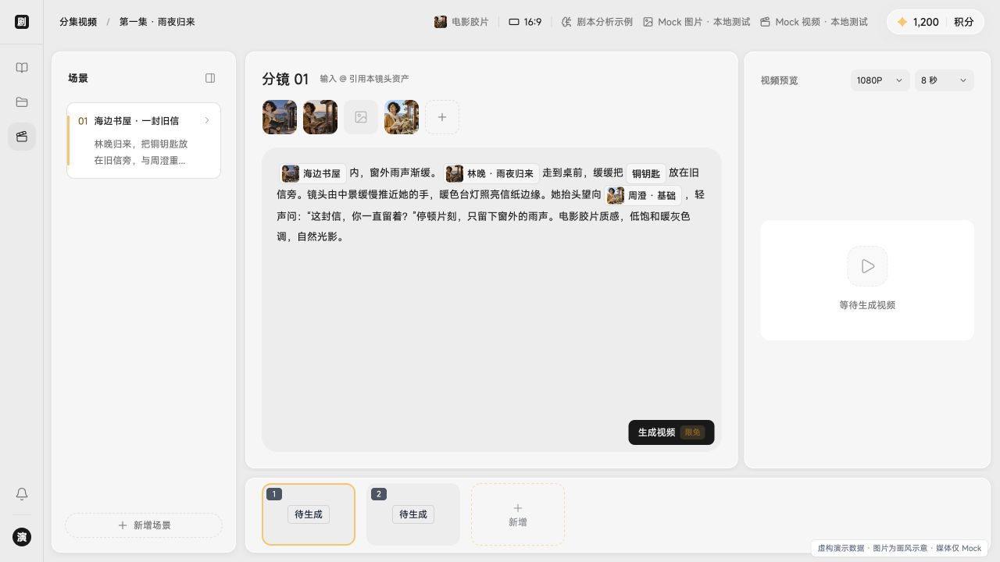 | 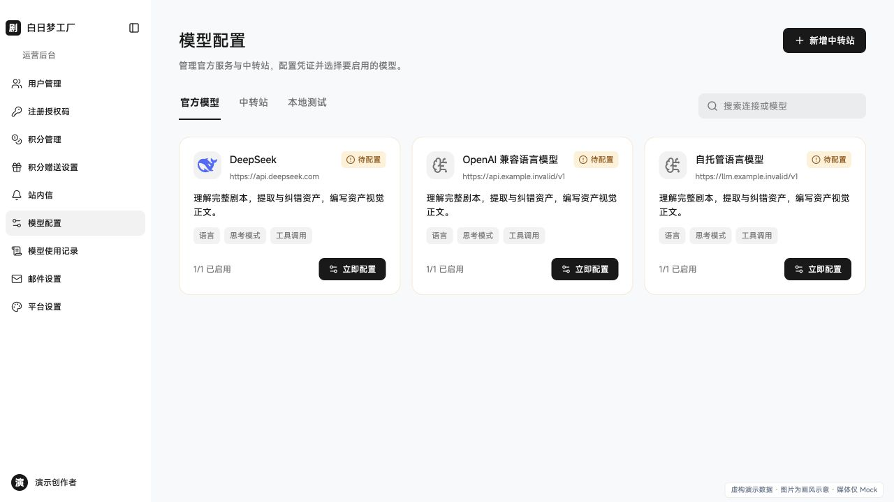 |

### 团队协作

- **个人空间与团队空间**：同一账号可在个人空间和多个团队之间切换，项目、资产和积分按空间隔离。
- **成员与角色**：所有者、管理员、普通成员三种角色；支持邮箱邀请、7 天有效的邀请链接和加入申请审批，所有权转让需接收人确认。
- **项目共享与编辑占用**：可把项目共享给指定成员或全员（只读或可编辑），团队可设置成员之间的默认可见范围；同一项目同时只允许一人编辑，避免互相覆盖。
- **资源交接与动态**：成员离队后可把其项目、上传文件和创作资产整体移交；团队动态记录所有管理操作。
- **团队概览**：未分配与已分配积分、消耗趋势、成员用量排行、团队套餐与待处理申请一屏可见。

| 团队概览 | 成员管理 |
| --- | --- |
| 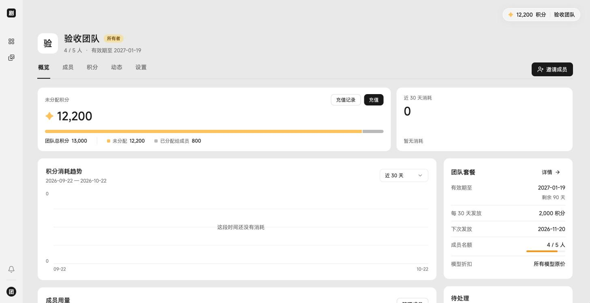 | 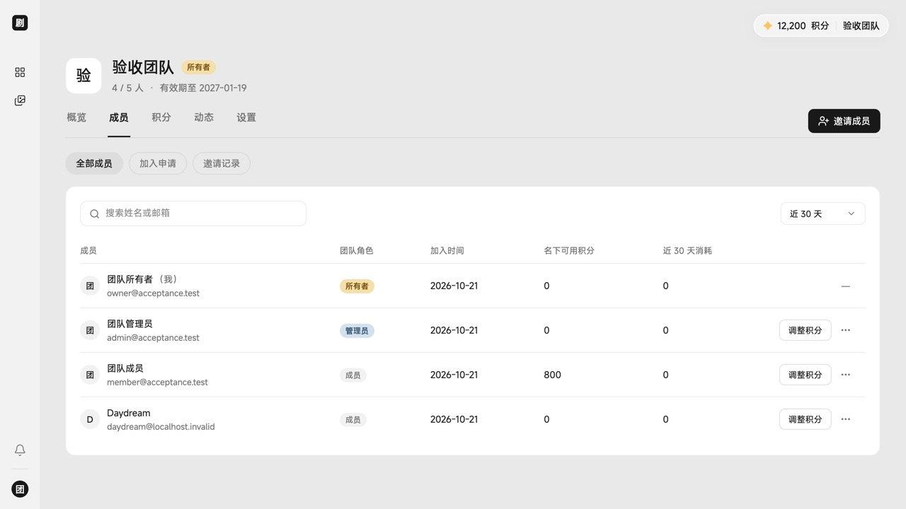 |

### 积分与计费

- **按模型计价**：运营为每个模型设置积分价格，可设限时免费；团队可单独设置模型折扣。
- **团队积分分配**：团队积分由所有者统一充值；所有者和管理员给成员分配、收回积分，只有所有者可以给管理员分配。成员和管理员只花本人名下的积分，不足时可一键申请。
- **团队套餐**：运营为团队开通合同，设置人数上限、有效期和每 30 天自动发放的积分。
- **个人积分**：注册赠送、每日赠送与充值积分分类记账，赠送积分可设置有效期；提供获取、消耗、到期明细与消耗分析。

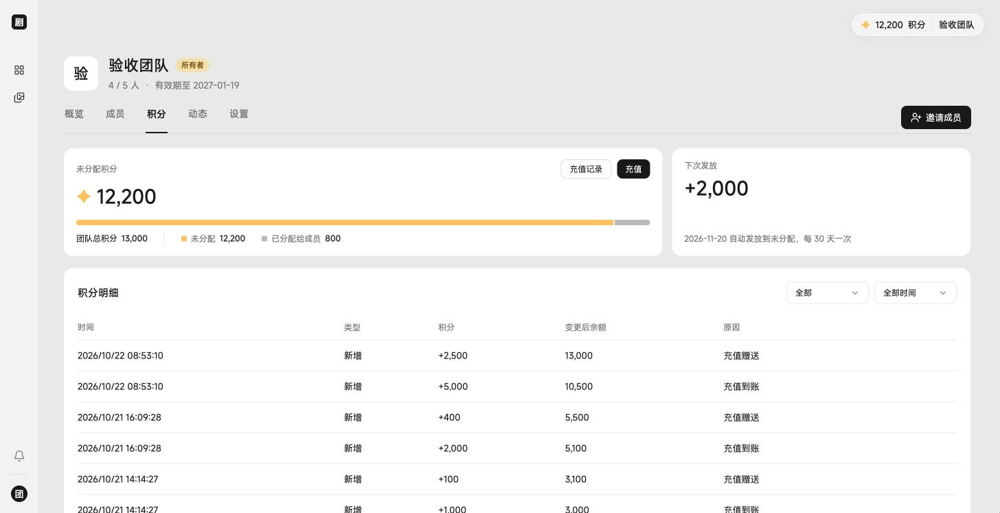

### 充值与支付

- **收银台**：固定充值档位，可配置赠送比例与限时优惠；个人空间与团队都能充值，团队仅所有者可充值。
- **支付渠道**：电脑网页微信 Native 支付、支付宝当面付扫码，以及无需商户的演示收银台；渠道默认全部关闭，按需在配置中开启。
- **订单与退款**：用户可从积分页的「充值记录」查看本人订单；运营可按渠道事实核查到账、处理退款与对账异常，退款时同比例扣回赠送积分。
- **协议页**：用户服务协议、隐私政策和积分充值协议以独立页面在新标签页打开，未登录也可阅读；正文为示例，正式条款请自行替换。

| 充值收银台 | 充值记录 |
| --- | --- |
| 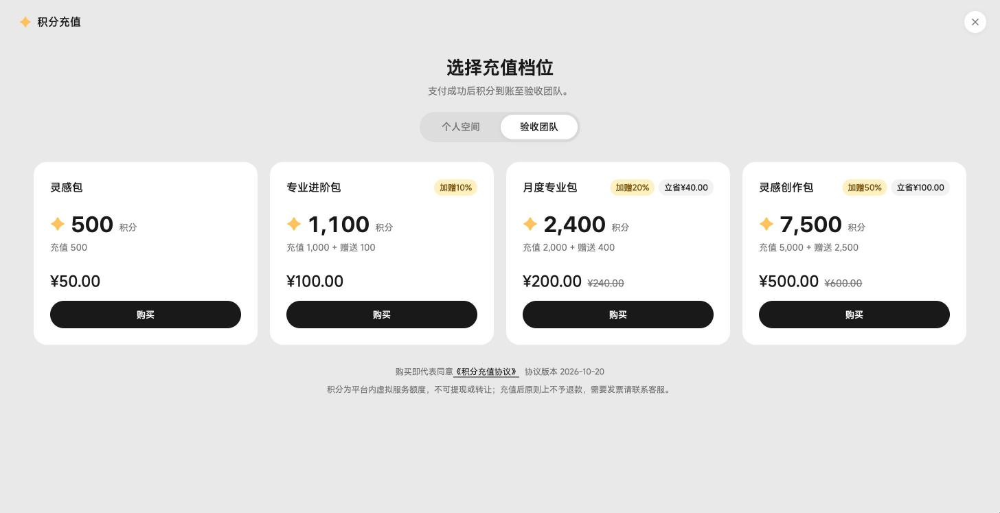 | 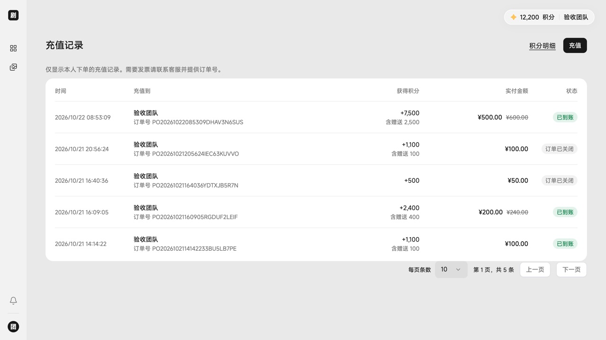 |

真实支付渠道只做过离线验证，未经真实商户联调；接入前请阅读[支付与商户部署](guide/payments.md)。

### 运营后台

- **用户与组织**：用户管理、注册授权码、团队开通与合同（人数、有效期、发放积分、模型折扣、启停与更换所有者）。
- **模型**：配置模型连接与凭据，文本分析已适配 DeepSeek、OpenAI Chat 兼容协议、火山引擎和 Google；设置积分价格与免费规则，查看调用用量。
- **积分与支付**：账户积分调整、赠送策略、充值档位与单日限额、支付订单与支付异常。
- **消息与平台**：站内通知群发、邮件服务配置、平台名称与品牌设置。

| 团队合同 | 支付订单 |
| --- | --- |
| 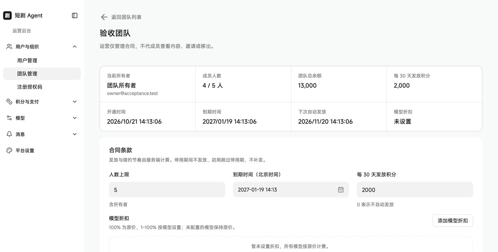 | 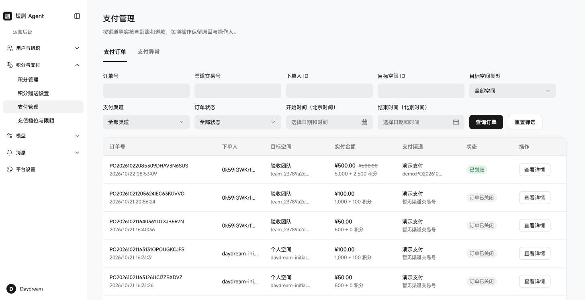 |

### 其他

- 中文 / 英文界面随时切换，浅色与深色主题。
- 账号支持密码登录与邮箱验证码登录、找回密码。
- 站内信通知团队邀请、角色变更、积分申请等事件，并可直达相关页面。

## 当前限制

- 文本分析需要自备可用的模型与凭据，协议兼容性以实际模型为准。
- **图片和视频任务目前仅支持本地免费 Mock**，用于体验任务提交、状态和结果流程；真实媒体厂商尚未接入。
- 支付渠道未经真实商户联调，本仓库不包含商户号、私钥或真实资金测试结果。

## 使用指南

- [部署与第一次使用](guide/deployment.md)
- [运行、更新与备份恢复](guide/maintenance.md)
- [支付与商户部署](guide/payments.md)
- [常见问题与排障](guide/troubleshooting.md)
- [源码构建、字体与贡献](guide/building.md)

## 许可

项目代码采用 [Apache-2.0](LICENSE)；MiSans 字体和第三方组件保留各自许可，见 [NOTICE](NOTICE)。本仓库提供自部署源码，不提供托管服务。
